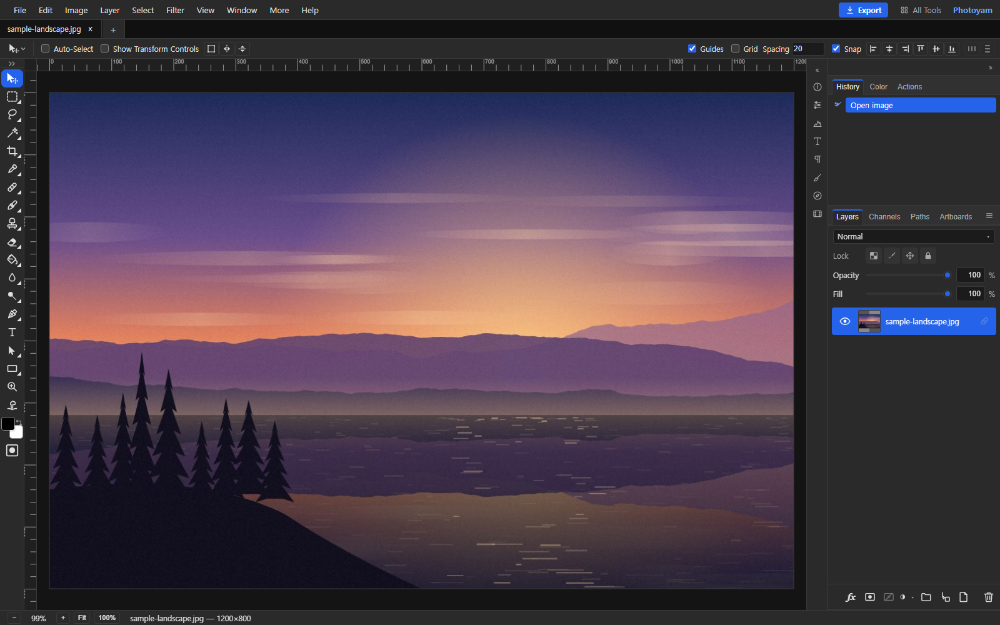

# Photoyam 🎨

**A free, Photoshop-class image editor that runs entirely in your web browser.**
No account. No upload. No install. Just open a URL and start editing.

### 👉 **[Open Photoyam → photoyam.com](https://photoyam.com)**
### 💬 **[Join the Discussions](https://github.com/photoyam/community/discussions)** — bugs, ideas, questions, and show-and-tell

---

## 🔒 Your images never leave your device

This is the part we care about most: **Photoyam has no backend.** There is no
server that receives, processes, or stores your images. Opening a photo, every
brush stroke, every filter and the final export all happen **inside your own
browser tab**.

- **Nothing is uploaded.** Your photos are read straight from your disk into the
  browser and never sent anywhere — and that includes the AI background remover,
  whose model runs on your device.
- **No account.** You don't sign in, and there is nowhere for your work to be
  collected.
- **You keep the files.** Press **Export** (top right) to download a JPG, PNG,
  WebP, PSD or `.psy` project — or **Share** it straight to Photos on a phone.
- **Unsaved work is protected, locally.** Every couple of minutes, and whenever
  you switch away from the tab, Photoyam keeps a recovery copy of your open
  documents in your browser's own storage. If the tab closes or crashes, the
  start screen offers **Recover unsaved work** next time. Recovery copies are
  removed when you save or export, can be turned off in *Edit ▸ Preferences ▸
  File Handling*, and never leave your device.

If privacy matters to you — client work, personal photos, sensitive documents —
Photoyam is safe by design: there's simply no server for your data to end up on.
The details are in the [privacy policy](https://photoyam.com/privacy).

---

## ✨ What Photoyam can do

**A real editor, not a toy:**

- **Layers & groups** — blend modes, opacity/fill, clipping masks, nested groups,
  and **layer styles** (drop shadow, stroke, bevel & emboss, glows, satin and
  overlays — several strokes or shadows on one layer, like Photoshop).
- **Non-destructive adjustments** — levels, curves, hue/saturation, color
  balance, exposure, channel mixer, selective color, gradient map, black & white
  and more, as re-editable adjustment layers.
- **Masks & selections** — layer and vector masks, alpha channels, marquee,
  lasso (incl. magnetic), magic wand, quick selection, color range, select
  subject and refine edge.
- **Retouching & painting** — a real brush engine with dynamics and pen pressure,
  clone stamp, healing / spot healing, content-aware fill, dodge / burn, smudge.
- **Filters** — blurs, sharpening, noise, distortions, Camera Raw, liquify and
  more, with GPU acceleration and **smart filters**. Long jobs can be cancelled.
- **Text, shapes & paths** — editable text in 40+ web fonts (including Korean,
  Japanese and Chinese), shape layers and a pen tool with bezier paths.
- **Animation** — open and edit animated GIF / APNG / WebP frame by frame.
- **Real PSD files** — open PSDs with their layers, and export PSDs whose layer
  effects stay editable when you open them in Photoshop.

**Quick tools that work right on their own page** — no editor needed, nothing
uploaded, batch + ZIP download:

- Convert: [HEIC to JPG](https://photoyam.com/heic-to-jpg),
  [HEIC to PNG](https://photoyam.com/heic-to-png),
  [WebP to PNG](https://photoyam.com/webp-to-png),
  [PNG/JPG to WebP](https://photoyam.com/png-to-webp),
  [AVIF to JPG](https://photoyam.com/avif-to-jpg),
  [PNG to ICO favicon](https://photoyam.com/png-to-ico) and
  [any format](https://photoyam.com/convert).
- Edit: [remove background](https://photoyam.com/remove-background),
  [resize](https://photoyam.com/resize), [crop](https://photoyam.com/crop),
  [compress](https://photoyam.com/compress), [add text](https://photoyam.com/add-text),
  [blur faces](https://photoyam.com/blur-image), [black & white](https://photoyam.com/grayscale),
  [PSD viewer](https://photoyam.com/psd-viewer).
- GIF & video: [video to GIF](https://photoyam.com/video-to-gif),
  [GIF to MP4](https://photoyam.com/gif-to-mp4),
  [add text to GIF](https://photoyam.com/add-text-to-gif),
  [GIF compressor](https://photoyam.com/gif-compressor) and more.
- PDF: [merge](https://photoyam.com/merge-pdf), [split](https://photoyam.com/split-pdf),
  [compress](https://photoyam.com/compress-pdf), [PDF to JPG](https://photoyam.com/pdf-to-jpg),
  [JPG to PDF](https://photoyam.com/jpg-to-pdf).

Every tool is listed at **[photoyam.com/tools](https://photoyam.com/tools)**, and
step-by-step tutorials live at **[photoyam.com/guides](https://photoyam.com/guides)**.

**Made to be pleasant to use:**

- **Install it as an app** (*Help ▸ Install Photoyam…*) — it opens in its own
  window, works offline and can open image files from your computer.
- **Remembers your setup** — tool options per tool, colors, export settings.
- **Command palette** and **customizable keyboard shortcuts** with a Photoshop
  preset.
- **Themes** and saveable panel workspaces.
- **5 languages** — English, 한국어, 日本語, 中文, Español.
- **Works on phones & tablets** — touch-friendly options bar, pinch-to-zoom,
  two-finger pan.

---

## 💬 Give feedback here

We'd love to hear from you in the
**[Discussions](https://github.com/photoyam/community/discussions)** tab — or
use *Help ▸ Report a Problem…* inside the editor, which fills in the technical
details for you (never your images or file names).

| Category | Use it for |
|---|---|
| 🙋 **Q&A** | Something broke, or you're stuck? Tell us what you did, what you expected, your browser + OS, and add a screenshot. |
| 💡 **Ideas** | Request a feature — and upvote (👍) the ones you want most. |
| 💬 **General** | Anything else about Photoyam. |
| 🖼️ **Show and tell** | Share what you made with Photoyam! |

Prefer email? Write to **contact@photoyam.com**.

---

*This repository intentionally contains no source code — it exists only to host
this public community space.*
